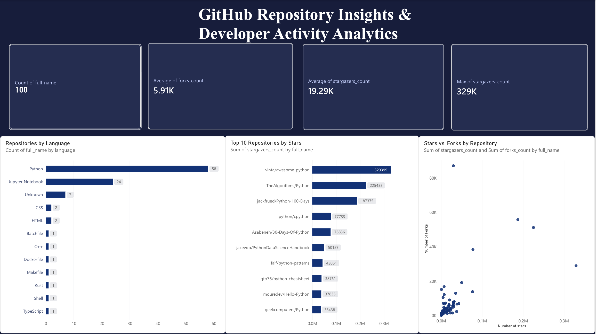

# GitHub Repository Analytics

## 📌 Project Overview
This project analyzes 100 GitHub repositories related to Python to explore repository popularity, programming language distribution, and developer engagement through stars and forks.

The analysis uses Python for data collection and preparation, SQL for querying and analysis, and Power BI for interactive visualization.

## 📊 Power BI Dashboard



## 🎯 Objectives
- Collect repository data using the GitHub REST API.
- Clean and prepare repository data for analysis.
- Analyze stars, forks, programming languages, and repository age.
- Identify popular repositories and explore the relationship between stars and forks.
- Build a Power BI dashboard to communicate key findings.

## 🛠️ Tools & Technologies
- **Python:** Data collection and processing
- **Pandas:** Data cleaning and transformation
- **GitHub REST API:** Repository data source
- **MySQL:** Data storage, validation, and SQL analysis
- **Power BI:** Dashboard creation and visualization

## 🔄 Project Workflow
1. Retrieved repository information from the GitHub REST API.
2. Processed and cleaned the dataset using Python and Pandas.
3. Stored and analyzed the data using MySQL.
4. Created an interactive Power BI dashboard with KPI cards, a programming-language distribution chart, a Top 10 repositories by stars chart, and a stars-versus-forks scatter chart.
5. Interpreted the results to identify patterns in repository popularity and engagement.

## 📊 Key Findings
- **100 repositories** were analyzed.
- Python was the most common programming language in the dataset, with 58 repositories.
- Jupyter Notebook was the second most common language, with 24 repositories.
- The average repository had approximately **19,288 stars** and **5,908 forks**.
- `vinta/awesome-python` ranked first with **329,399 stars**.
- `TheAlgorithms/Python` ranked second with **225,455 stars**.
- Stars and forks showed a positive correlation of approximately **0.61**, indicating that repositories with more stars tended to have more forks in this sample.
- Repository age had only a weak relationship with stars in this dataset.

## 📁 Project Files

- `test_api.py` — Python script for GitHub API data collection and processing.
- `github_repository_analysis.csv` — Cleaned dataset containing 100 GitHub repositories.
- `Power BI dashboard.png` — Screenshot of the Power BI analytics dashboard.
- `README.md` — Project overview, workflow, tools, and key findings.

## 🚀 How to Run
1. Install Python and the required libraries.
2. Download or clone this repository.
3. Install the required dependencies, such as Pandas and Requests, if used by the script.
4. Run the Python script:

   ```bash
   python3 test_api.py
   ```

5. Import the CSV into MySQL or a compatible analysis tool to explore the dataset.

*Note: Check the script for its exact dependencies and output paths before running it in a new environment.*

## 🔮 Future Improvements
- Expand the analysis to repositories across multiple programming languages.
- Track repository metrics over time to measure changes in popularity.
- Add contributor, issue, and pull-request analysis.
- Publish the interactive Power BI report and include its public viewing link.

## 👩‍💻 Author
**Sharadha Kattalingannagari**

